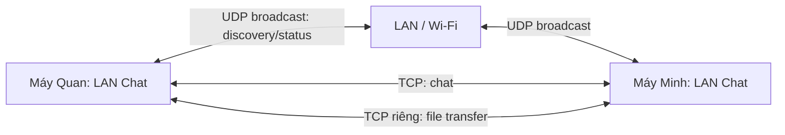
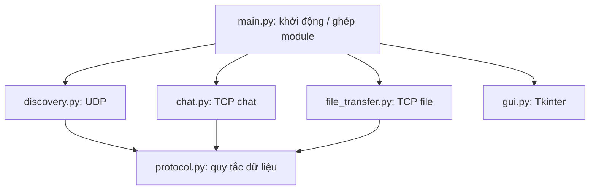

# Kiến trúc hệ thống (bản dễ hiểu)

> Cập nhật 09/11/2026: GUI/file/framing đã có code. Các luồng UDP/chat/main
> bên dưới vẫn chờ member 1–2. Quyết định chính xác theo [PROTOCOL](PROTOCOL.md)
> và [bàn giao member 3](MEMBER_3_HANDOFF.md), thay cho các đề xuất cũ.

## 1. Mô hình chính

- **P2P (ngang hàng):** Không có máy chủ chat trung tâm. Mỗi ứng dụng vừa **lắng nghe TCP** từ người khác vừa **chủ động kết nối TCP** khi người dùng chọn chat.
- **UDP:** Tìm ai đang có mặt và trạng thái online/away.
- **TCP:** Nhắn tin và gửi file đáng tin cậy.
- **Tkinter GUI:** Hiển thị, nhận thao tác. **GUI không trực tiếp đọc socket**.

## 2. Một phiên làm việc từ đầu đến cuối

1. Quan mở app, nhập tên; ứng dụng bật UDP listener và TCP listener.
2. Quan phát `HELLO|Quan|5000|online` mỗi **3 giây** bằng UDP broadcast.
3. Máy Minh nhận được, lấy **IP nguồn gói UDP** và TCP port trong message để thêm Quan vào online list.
4. Quan chọn Minh trên GUI: dùng IP và TCP port **của Minh** để thiết lập TCP connection.
5. Hai người nhắn tin hai chiều; tin của người khác được lưu và báo số chưa đọc.
6. Quan chọn file: file được gửi qua TCP; GUI hiện %; chat không bị khóa.
7. Nếu không thấy presence từ peer sau **10 giây**, xóa khỏi danh sách hiện diện. Nếu TCP bị ngắt, hiển thị lỗi mà không crash.

## 3. Sơ đồ các file Python

| File | Sở hữu | Làm gì? |
|---|---|---|
| `main.py` | Member 1 | Tạo các module, nối sự kiện, mở/đóng ứng dụng |
| `discovery.py` | Member 1 | Broadcast, nhận UDP, peer list, online/away, timeout |
| `chat.py` | Member 2 | TCP listener, connect, send/receive, lịch sử, unread |
| `protocol.py` | Member 2 điều phối, cả nhóm thống nhất | Định dạng message và hàm encode/decode dùng chung |
| `file_transfer.py` | Member 3 | Gửi/nhận byte file, tiến độ, lưu file, xóa file dở |
| `gui.py` | Member 3 | Màn hình và thao tác người dùng; cập nhật từ sự kiện |

## 4. Chạy song song mà không đứng GUI

- **Luồng GUI:** xử lý nút bấm và hiển thị.
- **Luồng UDP:** broadcast và nhận presence.
- **Luồng TCP:** lắng nghe kết nối; nhận tin nhắn từ peer.
- **Luồng file:** đọc/gửi file nền.

Luồng mạng **không cập nhật widget Tkinter trực tiếp**: đẩy dữ liệu vào hàng đợi (queue) để luồng GUI cập nhật. Dữ liệu chung (online list, lịch sử, unread) cần được quản lý nhất quán, có lock khi cần.

## 5. Các module cần đưa cho nhau cái gì?

| Từ → Đến | Dữ liệu/điều khiển |
|---|---|
| Discovery → Chat | Peer gồm `name`, `ip`, `tcp_port`, `status` để kết nối |
| Discovery → GUI | Thêm/cập nhật/xóa peer, đổi online/away |
| Chat → GUI | Tin đến, lịch sử, unread, lỗi kết nối |
| File Transfer → GUI | Tên file, tổng byte, byte đã gửi, %, thành công/lỗi |
| GUI → Modules | Lệnh chọn peer, gửi chat, đổi status, gửi file, đóng phiên |

Hàm và dữ liệu cụ thể cho triển khai member 3 đã ghi trong [PROTOCOL.md](PROTOCOL.md)
và [MEMBER_3_HANDOFF.md](MEMBER_3_HANDOFF.md); member 1–2 dùng các hợp đồng này để ghép.

## 6. Lựa chọn đã dùng cho member 3

- Có **một TCP listener** trên mỗi ứng dụng; phân biệt kết nối chat và kết nối gửi file theo quy ước mở đầu mà cả nhóm thống nhất.
- **Dùng TCP connection riêng cho từng lần gửi file** để không làm nghẽn luồng byte chat. Đây là quyết định thiết kế triển khai, không phải yêu cầu bắt buộc của đề.
- **Một nơi đọc mỗi socket**; không để `chat.py` và `file_transfer.py` cùng `recv()` trên cùng socket.
- Khi file bị ngắt giữa chừng: thông báo lỗi, xóa file nhận dở trong `downloads/`.

## 7. Cách kiểm tra hệ thống hoàn chỉnh

- Hai máy cùng LAN/Wi-Fi có thể thấy nhau, trạng thái thay đổi và mất sau timeout.
- Gửi tin hai chiều, nhiều tin liên tiếp, tin đến khi đang gõ, và unread từ peer khác.
- Truyền file thành công, đúng nội dung, progress tăng; vẫn chat bình thường.
- Mất kết nối, gửi file lỗi, đóng app: có thông báo và không làm app crash.
