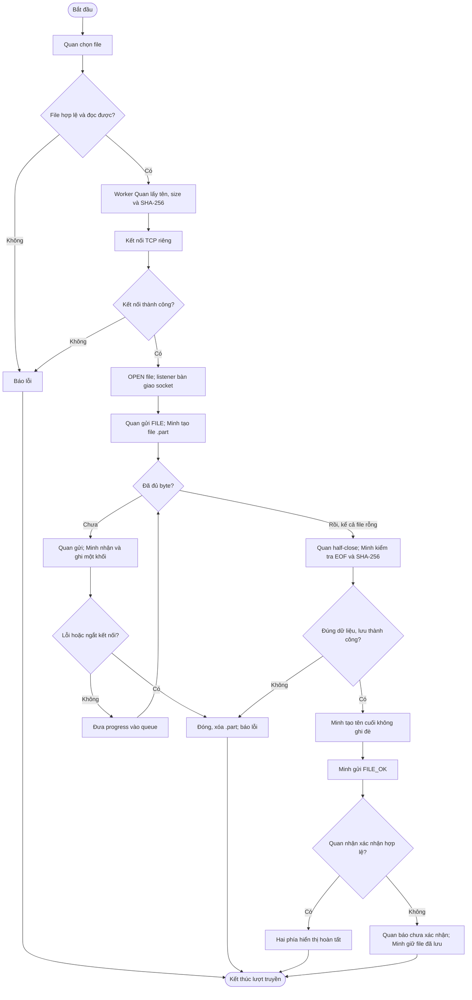
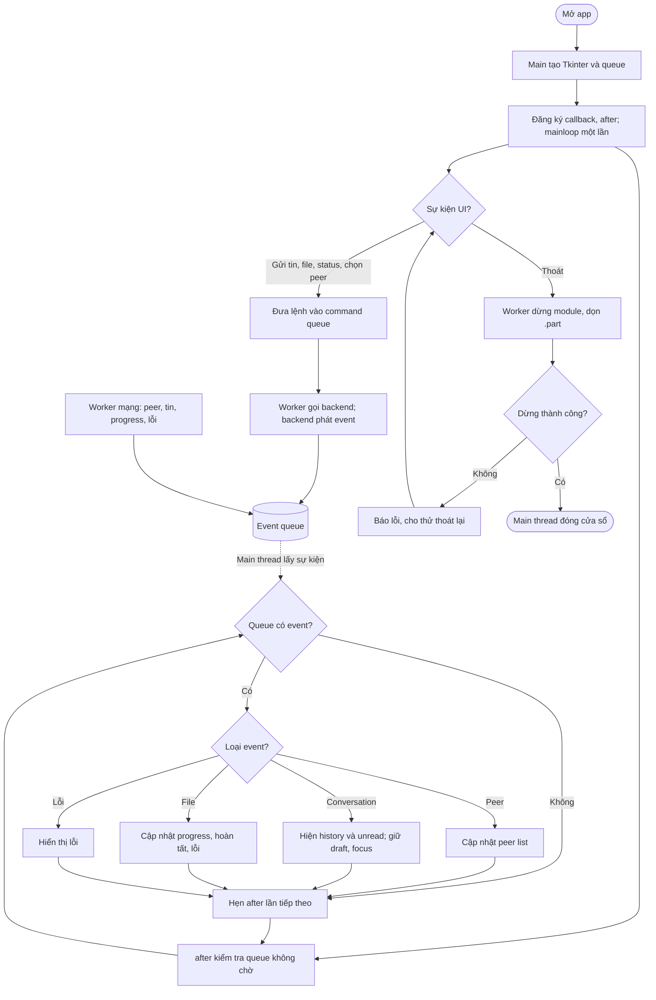

# Member 3 — Cách chạy và bàn giao

Ngày triển khai: **09/11/2026**. Repo: `LAN_Chat_Simplified/LAN_Chat_Simplified`.
Chỉ dùng thư viện chuẩn. Đã chạy với Python 3.14.6, Tk 8.6.15 trên Windows.
Code dùng cú pháp Python 3.10+; phiên bản khác chưa chạy kiểm chứng.

Member 1–2 bắt đầu code theo [TEAM_WORKFLOW](TEAM_WORKFLOW.md): quyền sửa file,
API service cụ thể và thứ tự Git/merge. Các ví dụ dưới đây dùng cùng hợp đồng đó.

## 1. Đã làm và phần cần ghép

- `src/file_transfer.py`: gửi/nhận TCP thật trong worker, SHA-256, progress,
  xác nhận, file rỗng/nhị phân/Unicode, tên an toàn/trùng tên, hủy/dừng/dọn lỗi.
- `src/gui.py`: Tkinter, tên/status/peer IP, chat/history/unread, Enter gửi,
  draft từng người, chọn file, nhiều lượt truyền/progress/hủy, rời chat/help/thoát.
- `src/protocol.py`: framing dùng chung theo [PROTOCOL.md](PROTOCOL.md).
- `src/member3_demo.py`: adapter chạy riêng. **File TCP thật; discovery, chat,
  status mô phỏng**. Không dùng thay code của member 1–2.
- `tests/`: framing, truyền file/lỗi, GUI callback/event, GUI trong lượt truyền TCP thật.

`main.py`, `discovery.py`, `chat.py` vẫn là phần chưa triển khai của member 1–2.
Ứng dụng tích hợp, chat thật trong lúc gửi file, hai máy vật lý và Wireshark
chưa được nghiệm thu. Bản local không giả thành công các bước này.

## 2. Chạy ngay

Mở terminal tại thư mục chứa README:

```powershell
python -m src.member3_demo
```

Chọn Minh/Lan để thử chat mô phỏng. File gửi tới peer chưa mở app sẽ báo lỗi
kết nối thật. Thử **file TCP hai chiều trên một máy** bằng hai terminal:

```powershell
# Terminal 1
python -m src.member3_demo --name Quan --port 5000 --peer 127.0.0.1:5001 --downloads downloads/Quan
# Terminal 2
python -m src.member3_demo --name Minh --port 5001 --peer 127.0.0.1:5000 --downloads downloads/Minh
```

Chọn peer, Chọn file. Chat của bản thử chỉ echo tại máy cục bộ với nhãn
`[Mô phỏng]`; không đi qua mạng.

Thử **file trên hai máy thật**, thay đúng IP:

```powershell
# Quan, IP 192.168.1.10
python -m src.member3_demo --name Quan --ip 192.168.1.10 --port 5000 --peer 192.168.1.20:5000
# Minh, IP 192.168.1.20
python -m src.member3_demo --name Minh --ip 192.168.1.20 --port 5000 --peer 192.168.1.10:5000
```

Cùng LAN, cho phép TCP port đã chọn qua firewall. `--ip` là IPv4 nguồn thật,
không để loopback khi gửi sang máy khác. `--bind` mặc định 0.0.0.0, `--downloads`
tùy chỉnh thư mục nhận, mặc định repo/downloads/.

```powershell
python -X utf8 -m unittest discover -s tests -v
```

## 3. Member 1 nối GUI

Ví dụ tích hợp sau dùng object discovery/chat do member 1–2 cung cấp;
đây không phải các class đã tồn tại trong skeleton:

```python
import queue
from src.file_transfer import FileTransferManager
from src.gui import UIActions, run_ui

events = queue.Queue()  # Không đặt maxsize.
local = {"name": "Quan", "ip": "192.168.1.10", "tcp_port": 5000,
         "peer_id": "192.168.1.10:5000", "status": "online"}
files = FileTransferManager(local, events)

def send_file(peer_id, path):
    return files.send_file(discovery.get_peers()[peer_id], path)

def shutdown():
    errors = []
    for stop in (discovery.stop_discovery, chat.stop_listener, files.stop_transfers):
        try:
            stop()
        except Exception as exc:
            errors.append(str(exc))
    if errors:
        raise RuntimeError("; ".join(errors))

actions = UIActions(chat.select_peer, chat.send_message, send_file,
                    discovery.set_status, chat.leave_chat,
                    files.cancel_transfer, shutdown)
# Start TCP listener, đăng ký FILE handoff, rồi start discovery trước run_ui.
run_ui(local["name"], events, actions)  # Main thread.
```

GUI gọi callbacks trên **một command worker theo thứ tự**. Chúng nhận lệnh và
trả nhanh; chat connect/send tự chuyển I/O sang worker. Không gọi Tk trong callback.
`shutdown()` được chờ stop/join vì đã ngoài UI. Stop của nhóm phải idempotent.
Lỗi callback hiện trên GUI; lỗi nhận lệnh gửi giữ nguyên draft.

`send_message(peer_id,text)` trả thành công nghĩa là backend nhận yêu cầu vào
history/hàng đợi, chưa đảm bảo giao tin. Nếu gửi sau đó lỗi, backend cập nhật
message state="failed" và operation_failed. `select_peer` đổi active/reset unread
nguyên tử rồi phát snapshot kể cả history rỗng. `leave_chat` chỉ đóng chat,
giữ history/file. Discovery phát status_changed sau khi đổi trạng thái cục bộ.

## 4. Member 2 bàn giao FILE

```python
from src.protocol import recv_frame, ProtocolError

def handle_new_connection(conn, source_ip):
    # Chạy trong worker handshake, không phải accept loop hoặc Tk thread.
    handed_off = False
    try:
        conn.settimeout(3)
        opening, _ = recv_frame(conn)  # Chỉ đọc OPEN, không đọc dư FILE.
        if opening["type"] != "OPEN":
            raise ProtocolError("Frame đầu phải là OPEN")
        if opening.get("purpose") == "file":
            handed_off = True  # Manager sở hữu/đóng cả khi từ chối.
            files.receive_file(conn, opening, source_ip)
        elif opening.get("purpose") == "chat":
            chat.accept_session(conn, opening, source_ip)
            handed_off = True
        else:
            raise ProtocolError("OPEN purpose không hợp lệ")
    finally:
        if not handed_off:
            conn.close()
```

`FileDemoListener` là mẫu chạy được cho FILE-only listener. Manager không tự bind
listener thứ hai trong ứng dụng tích hợp. Không hai thread cùng recv; không
`with conn:` đóng socket sau khi bàn giao. FILE body stream trực tiếp ra đĩa.

## 5. Schema sự kiện backend → GUI

Dictionary mới/bản chụp, không sửa object sau put. GUI là consumer duy nhất.
Worker có thể gọi `window.post_event(event)` (chỉ queue.put, không Tk).

```python
{"type": "peer_upsert", "peer": peer_dict}
{"type": "peer_removed", "peer_id": "192.168.1.20:5000"}
{"type": "status_changed", "status": "away"}
{"type": "operation_failed", "error": "Không kết nối được Minh"}

{"type": "conversation", "peer_id": "192.168.1.20:5000", "revision": 7,
 "unread": 0, "messages": [
     {"text": "Chào Minh", "outgoing": True, "state": "sent"},
     {"text": "Chào Quan", "sender": "Minh", "outgoing": False}
 ]}
```

Revision tăng theo peer từ 0/1. GUI bỏ snapshot cũ/bằng; peer khác chỉ đổi unread,
không đổi hội thoại/focus/draft. Chat là nguồn chuẩn history/unread.

```python
{"type": "transfer_progress", "transfer_id": "UUID", "peer_id": "IP:port",
 "direction": "send", "filename": "project.pdf", "total_bytes": 100,
 "bytes_done": 60, "percent": 60.0, "stage": "transferring"}
```

Manager tự phát transfer_started/progress/completed/failed/cancelled. Stage:
preparing/transferring/awaiting_confirmation. Hoàn tất có sha256 và path (nhận)
hoặc saved_as (gửi); lỗi có error, saved. File đã lưu không xóa khi mất ACK.
Backend không phát `ui_command_result`: event này là nội bộ GUI.

## 6. Flowchart hoàn chỉnh

F1 ghép hai phía để dễ đọc; OPEN do listener member 2 đọc rồi bàn giao.



I/O/hash chạy nền. Hủy/tắt trước khi lưu hoàn chỉnh đi về dọn .part. Nếu xóa lỗi,
báo rõ đường dẫn. GUI không trực tiếp đọc/ghi socket hoặc tính hash.



## 7. Bảng hàm member 3

| Hàm | File | Input | Kết quả |
|---|---|---|---|
| `FileTransferManager.send_file` | file_transfer.py | peer dict, path | UUID ngay; event nền |
| `FileTransferManager.receive_file` | file_transfer.py | socket, OPEN, source IP | UUID; sở hữu và đóng socket |
| `cancel_transfer` / `stop_transfers` | file_transfer.py | UUID / timeout | hủy, dừng, dọn file dở |
| `run_ui` | gui.py | username, queue, UIActions | Tk mainloop trên main thread |
| `ChatWindow.post_event` | gui.py | event dict | đưa queue an toàn từ worker |

## 8. Bổ sung phần còn trống trong PDF

**A3:** HELLO quảng bá tên/TCP port/status. IP lấy từ nguồn datagram, 5000 lấy
từ nội dung. Away vẫn phát presence; offline là không thấy hiện diện sau timeout.

**A4:** UDP không cần thiết lập connection; broadcast gửi presence tới listener
trên port chung trong miền broadcast. Máy nhận lưu last_seen; vòng timeout vẫn
chạy khi không có gói để loại peer quá 10 giây.

**A5:** SYN → SYN-ACK → ACK do OS xử lý khi connect/accept, không tự gửi chuỗi SYN.
Kết nối TCP là luồng byte hai chiều dùng cho nhiều MSG đã framing. Client là
bên chủ động mở kết nối, không phải bên chỉ được gửi.

**A6:** Quan xem chat Minh và progress file; hai tin Lan được chat lưu/unread=2.
GUI cập nhật badge, giữ draft/focus, không tự chuyển chat. Chọn Lan hiện history
và unread=0, file vẫn chạy. Discovery quản lý presence; chat quản lý history/
unread; file quản lý bytes/progress; GUI hiển thị và chuyển lệnh qua callback.

**C1–C4:** Quyết định và giao diện cụ thể nằm trong PROTOCOL và mục 3–5. Đây là
lựa chọn theo ủy quyền của bạn, chưa thay review/xác nhận của thành viên khác.

**C5 — Kịch bản kiểm thử chung:**

| Bước | Kết quả mong đợi | Bằng chứng hiện tại |
|---|---|---|
| Chạy hai máy, TCP rồi UDP | thấy peer đúng tên/IP/port | Chờ member 1–2 và LAN |
| Đổi online/away | peer bên kia cập nhật, vẫn chat được | Chờ tích hợp |
| Chat hai chiều khi đang gõ | tin hiện ngay; giữ draft/focus | GUI local đã test; chat thật chờ |
| Peer thứ ba gửi 2 tin | unread=2; chọn peer hiện history/reset 0 | GUI snapshot đã test |
| Gửi file rỗng/nhị phân/Unicode/trùng tên | bytes/hash khớp, không ghi đè | TCP loopback đã test |
| Vừa truyền file lớn vừa chat | UI xử lý tin/lệnh gửi | File TCP + UI callback đã test; chat LAN chờ |
| Hủy/ngắt/tắt app khi truyền | lỗi/hủy, xóa .part, dừng worker | Local đã test; LAN vật lý chờ |
| Tắt peer không báo | bỏ peer sau 10 giây | Chờ member 1 |

**C6 — Câu hỏi để review, chưa có xác nhận của nhóm:**

- Hỏi member 2: OPEN mới đến một phần thì accept loop có đứng không? Hợp đồng:
  worker đọc đủ frame, timeout 3 giây; lỗi đóng riêng connection/phát lỗi.
- Hỏi member 1: Đóng app lúc nhận file thì ai chờ xóa .part? Hợp đồng: shutdown
  ngoài Tk dừng nguồn kết nối mới, stop_transfers/dọn file rồi mới đóng GUI;
  lỗi dọn dẹp được hiển thị và cho thử thoát lại.

## 9. Ghi chú viết báo cáo

GUI chạy main thread, nhận snapshot qua queue/after. Nút bấm đưa lệnh sang
worker. Chat backend giữ history/unread; GUI dùng revision bỏ snapshot cũ và
lưu draft theo peer. File TCP riêng tránh dùng chung luồng byte với chat.

Metadata JSON length-prefix, body nhị phân khối 64 KiB; receiver lưu .part,
kiểm byte/EOF/hash, đồng bộ đĩa rồi tạo tên cuối không ghi đè. FILE_OK phân biệt
gửi hết dữ liệu với nhận/lưu thành công. Lỗi/hủy đóng socket và dọn file dở.

Đánh đổi: tính hash cần đọc nguồn hai lần; hard link cần filesystem hỗ trợ (nếu
không, báo lỗi/dọn file, không giả thành công); không resume và không lưu history
qua phiên. ACK mất không tự gửi lại để tránh tạo bản sao ngoài ý muốn.

Kiểm thử local nằm trong tests/. Khi ghép nhóm cần bổ sung kết quả hai máy,
IP/port/OS, hash nguồn/đích, ảnh progress và Wireshark. Không dùng kết quả local
để khẳng định UDP/chat thật hoặc demo LAN đã hoàn thành.
