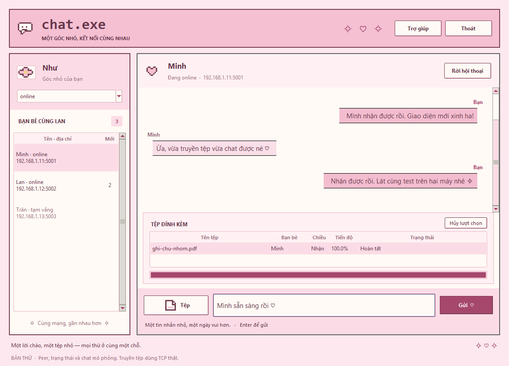
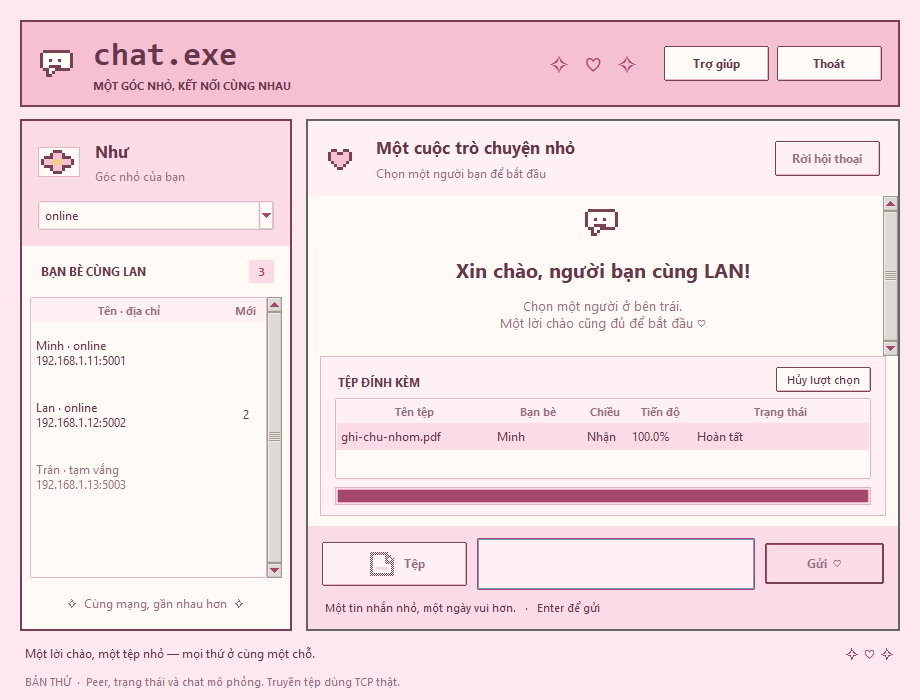

# Member 3 — Giao diện pastel / pixel

Cập nhật ngày 13/11/2026 trên nhánh `nhukei`, theo ảnh tham khảo của người phụ trách Member 3.

## Mở giao diện


### Demo hai cửa sổ Như ↔ Minh (13/11/2026)

Chạy **một lệnh** để kiểm tra ngay GUI và truyền tệp mà không cần cấu hình peer:

```powershell
python -m src.member3_demo --pair
```

- Tự mở Như và Minh, chọn sẵn đối phương và hiển thị cùng đoạn hội thoại mẫu.
- Gõ ở Như, nhấn Gửi: tin xuất hiện ở Minh; trả lời từ Minh xuất hiện ở Như.
- Bấm **Tệp** ở một cửa sổ, chọn file; theo dõi trạng thái Hoàn tất ở cả hai.
- File nhận bên Như: `downloads/pair-demo/nhu/`; bên Minh: `downloads/pair-demo/minh/`.
- Hai listener file bind loopback và tự chọn cổng trống; không cần tự nhập IP/port.
- Đóng một cửa sổ làm peer đó offline ở cửa sổ còn lại. Đóng cả hai sẽ dừng demo.
- Đổi thư mục nhận bằng `python -m src.member3_demo --pair --downloads <thu-muc>`;
  bên trong vẫn tách thư mục `nhu/` và `minh/`.

**Chat giữa hai cửa sổ được chuyển nội bộ trong cùng process để thử GUI,
không phải TCP ChatService của Member 2. File truyền qua TCP thật, kiểm SHA-256
và xác nhận lưu thật.** Không dùng chế độ này để nghiệm thu discovery/chat LAN.
Chế độ demo một cửa sổ và lệnh chạy hai instance độc lập bên dưới vẫn giữ nguyên.

Muốn xem một cửa sổ độc lập, dùng
`python -m src.member3_demo --name "Như"`; các peer mặc định trong chế độ đó
mô phỏng và không có listener nhận file. Cấu hình gửi file giữa hai process
hoặc hai máy theo [MEMBER_3_HANDOFF](MEMBER_3_HANDOFF.md).

## Thiết kế

- Sidebar trái: tên của bạn, online/away, danh sách bạn bè cùng LAN, IP/port và unread.
- Cột phải: tên/trạng thái peer, lịch sử chat, hoạt động truyền tệp, rồi ô nhập.
- Tiêu đề `chat.exe`, icon bong bóng/hoa/trái tim/tệp vẽ bằng Tk PhotoImage.
- Tin đến ở trái, tin gửi ở phải; bong bóng co theo nội dung và chiều rộng cửa sổ.
- Font Consolas cho tiêu đề, Segoe UI cho tiếng Việt; không cần cài font hoặc thư viện mới.
- Trạng thái chưa chọn peer có lời chào; gửi tệp/tin bị vô hiệu khi chưa có peer hợp lệ.
- Cửa sổ mặc định 1140 × 820; tối thiểu 920 × 700. Danh sách peer và chat có scrollbar.
- Thanh thông báo hiện lỗi/hoàn tất. Demo có nhãn riêng luôn hiển thị, không bị thông báo khác ghi đè.

| Vai trò | Màu |
|---|---|
| Nền | `#FCE8EE` |
| Giấy / vùng chat | `#FFFAF5` |
| Panel | `#FFF1F3` |
| Hồng chính | `#F5C0D2` |
| Nút gửi / điểm nhấn | `#A6476C` |
| Viền | `#784253` |
| Chữ chính | `#64374B` |

## Ảnh xem trước

Ảnh chụp cửa sổ Tkinter thật, dùng dữ liệu minh họa được tạo để kiểm tra giao diện.
Tên peer, nội dung chat và hàng truyền tệp trong ảnh là mô phỏng; ảnh không phải
bằng chứng chat/file thành công giữa hai máy LAN.





## Hợp đồng tích hợp

`UIActions`, `ChatWindow`, `run_ui` và schema event không đổi.
GUI tiếp tục nhận `conversation` snapshot, dùng revision bỏ snapshot cũ và hiển thị
unread do ChatService cung cấp; không tự quản lý history hoặc cắt còn 500 tin.

Callback vẫn chạy qua command worker; Tk chỉ cập nhật trên main thread.
Đổi peer giữ draft; tin mới không đổi focus/cursor; gửi lỗi giữ nội dung nhập.
Truyền tệp vẫn độc lập với rời hội thoại.
Icon được giải phóng trên Tk thread khi shutdown thành công.

Không sửa Discovery, ChatService, Protocol hay FileTransferManager trong lần thiết kế này.
Member 1 nối main theo TEAM_WORKFLOW; Member 2 dùng event hiện có.

## Kiểm tra

```powershell
python -X utf8 -m unittest discover -s tests -v
git diff --check
```

Kết quả hiện tại: **48 tests passed** (8 protocol, 21 file transfer, 15 GUI, 4 paired-demo).

Có regression cho snapshot 500 tin nhiều dòng/tiếng Việt, định dạng tin gửi/nhận
và giữ draft. Các test cũ về focus/cursor, unread/revision, gửi lỗi, shutdown và
truyền tệp TCP khi GUI xử lý chat vẫn đạt. Test harness thu gom tài nguyên Tk
trên main thread sau mỗi cửa sổ, tránh finalizer bị chạy trên network worker.

Đã xem ảnh ở 1140 × 820 và 920 × 700, gồm hội thoại có tin và chưa chọn peer.
Kiểm thử hai máy LAN và backend Member 1–2 vẫn theo checklist tích hợp chung.


## Bổ sung kiểm thử demo cặp

Đã kiểm tra tin qua lại hai cửa sổ không tự echo, unread/status, history 500 tin,
peer đóng thì không báo gửi thành công giả; gửi file TCP thật hai chiều với thư
mục nhận riêng và nội dung/hash khớp. Test GUI thực hiện nhập/gửi ở cả hai cửa sổ,
chọn file qua callback GUI và chờ cả hai phía Hoàn tất.
